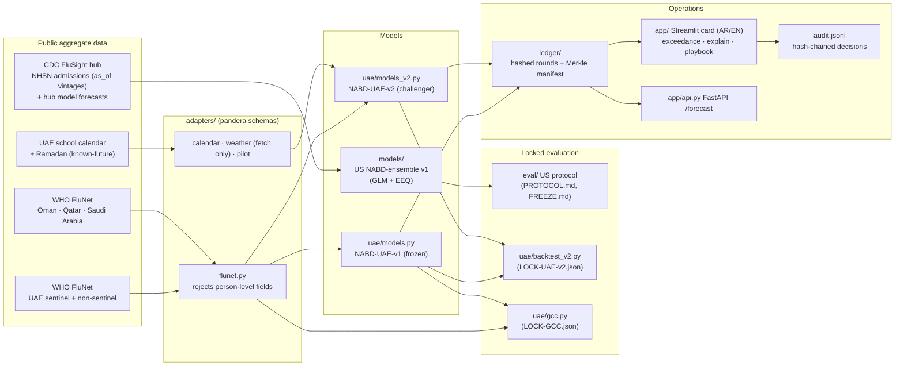

# NABD: Technical documentation

**Future Health Digital Innovation Challenge 2026 · Statement 06 (Population and Workforce Health Early Warning)**
**Version:** round 4, 8 Nov 2026, to be refreshed on 19–20 Nov.
**Repository:** this repo (the git history is the provenance record).

Every number below is copied from a file in `results/` and cited inline. Status labels used throughout: **PRE-REGISTERED** (plan locked before scoring), **RETROSPECTIVE** (data or earlier results had been seen), **DIAGNOSTIC** (thresholds informed by earlier exposure), **SIMULATED** (synthetic data) and **NOT RUN**. Protocol locks are local git commits. They are **self-attested until anchored outside the team** (§8).

---

## 1. What NABD is

NABD (نبض, "pulse") is an open forecasting layer for seasonal RSV and influenza. It issues probabilistic forecasts of weekly respiratory activity, from the nowcast to three weeks after issue (each forecast is labelled by its target week-ending date), with interval coverage measured and reported (§6). A bilingual (Arabic/English) decision card proposes a proportionate action for a named role, and only a person can approve, modify or dismiss it; a hash-chained audit log records the decision. Every forecast round is hashed and committed before its target week is observed. The record becomes public and externally timestamped once the repository is pushed and the manifests are anchored (§8). Until then it is self-attested.

It is built to sit on top of Abu Dhabi's existing detection systems (Tableegh/Malaffi notifications, UMOC early warning, Rasid wastewater), not to replace them (`research/positioning.md` §0, §3).

**Three tracks share one discipline:** fix the plan, lock it, score once, report everything.

| Track | Target | Role | Status |
|---|---|---|---|
| UAE | WHO FluNet UAE sentinel RSV and influenza positivity | The product: live ledger, decision card | v1 frozen; v2 challenger scored under a locked protocol (RETROSPECTIVE) |
| GCC | FluNet positivity in Oman, Qatar and Saudi Arabia | Out-of-sample test of the frozen UAE method | PRE-REGISTERED, locked before download; primary MET |
| US | NHSN state influenza admissions (CDC FluSight hub) | Stress test of method and discipline against the strongest public benchmark | PRE-REGISTERED; primary NOT MET |

---

## 2. Architecture

**Interface contract** (BUILD-SPEC v1.1): every forecast file uses the FluSight hub quantile format (`reference_date, target, horizon, target_end_date, location, output_type, output_type_id, value, model`) with the 23 FluSight quantile levels. The app and API read only `results/` and `ledger/`, and show "not yet computed" for anything missing. They never show demo numbers as if they were real.

**Privacy by construction:**
- Every adapter validates its input against a pandera schema that **rejects person-level fields** (id, name, patient, emirates_id, dob, mrn and similar); this is tested in `tests/test_adapters.py`.
- All data are weekly aggregates.
- The workforce module is a SIMULATED secure-aggregation design (k ≥ 10 employers) on synthetic counts, watermarked in the UI.

---

## 3. Data

| Source | Use | Access, vintages | Licence |
|---|---|---|---|
| WHO FluNet `VIW_FNT`, ARE, sentinel + non-sentinel, 2022-W01 → 2026-W44 | UAE inputs and truth | xMart OData; refreshed via WebFetch on 8 Nov. Lag at retrieval: 7 days for W44 (`data/raw/PROVENANCE.md`). No vintages exist, so retrospectives use revised values | WHO: public-health, non-commercial use, with citation |
| WHO FluNet, OMN/QAT/SAU (BHR, KWT screened out by rule) | GCC test | Downloaded **after** the lock (commit d013228 after lock 91005ce). WHO's full export (3 Oct 2026) via a public mirror. It matches our independently fetched UAE rows exactly (419/419) and 23/23 Gulf rows spot-checked against the official API (deviations G1, G1b). A full official re-pull (`python -m adapters.gcc_verify`) is pending | WHO terms |
| CDC FluSight hub `cdcepi/FluSight-forecast-hub`, pinned commit `d035740…` | US target data (102 `as_of` vintages, 2023-09-23 → 2026-11-04), FluSight-ensemble, FluSight-baseline and all hub models (league table) | Sparse git checkout in `external/hub`, pinned commit recorded in `eval/run_all.py` (HUB_SHA). Enforcement of the pin is tracked in `docs/DEVIATIONS.md` (D8(d) and its correction) | MIT (hub); US Government data |
| UAE MoE academic calendars (verified seasons only), Ramadan (tabular calendar ± 2 days) | v2 covariates (known-future) | `data/raw/uae_calendar.csv`, with source URLs per row | Public fact |
| NOAA GHCN / ERA5 weather | Planned covariate | **Not used.** Blocked in the build environment; `adapters/weather.py --fetch` works locally | Public domain |

**Positivity definition (UAE/GCC):** p = (positives + 0.5) / (specimens + 1), modelled on the logit scale y = logit(p). Weeks with < 20 specimens are excluded from season-shape statistics.

---

## 4. Models

### 4.1 NABD-UAE-v1: the frozen headline model (`uae/models.py`, commit da045ee)

For series s ∈ {flu, RSV} and data horizon h ∈ {1, 2, 3, 4}, a pooled linear growth model fitted on training seasons:

$$
y_{t+h} - y_t = a_h + b_h\,(y_t - y_{t-1}) + c_h\,(y_t - \bar y_{w(t)}) + d_h\,(\bar y_{w(t+h)} - \bar y_{w(t)}) + e_h\,\Delta\log \text{spec}_t + \varepsilon
$$

where $\bar y_{w}$ is the training-season mean logit by ISO week (circularly smoothed ± 2 weeks), and $\Delta\log\text{spec}_t$ is the 1-week change in log specimens processed (testing volume). Predictive quantiles are $y_t + \hat{(\cdot)} + Q_\tau(\hat\varepsilon)$, where the residuals come from **nested** leave-one-season-out fits within the training seasons, so the spread is out-of-sample. They are back-transformed to percent.

**Information rule:** a forecast issued after the last published week L uses only rows with week_end ≤ week_end(L). Targets are L+1 … L+4. With WHO's lag of about 7–11 days, the four targets are the nowcast and the weeks ending one, two and three weeks after issue. **Display convention, everywhere** (card, bulletin, API, planner, ledger): the primary label is the target week-ending date; the secondary label is whole weeks from issue to the target week's end ("nowcast", "+1/+2/+3 wk after issue"), the same as the hashed R0/R1 rounds. All skill numbers assume issue at L_end + 11 days (a conservative lag).

**Comparators:**
- **persistence:** median = the last logit; spread = the empirical h-step changes;
- **seasonal analog:** training-season values at the target ISO week ± 1.

### 4.2 NABD-UAE-v2: the multi-signal challenger (`uae/models_v2.py`; `docs/PROTOCOL-UAE-v2.md`)

$$
y_{t+h} - y_t = b_0 + \sum_k b_k x_k + \varepsilon
$$

with the following blocks. Lag features never cross a season boundary.

| Block | Features | Availability |
|---|---|---|
| CORE | Δy | through t |
| CLIM | anomaly vs climatology; climatology change to the target week | known |
| TV | Δ log sentinel specimens | through t |
| NS | non-sentinel Δz and gap (non-sentinel minus sentinel) | through t−1 |
| CAL | school-break fraction and Ramadan fraction over the target weeks | known-future |

**Missing-feed rule (pre-declared):** sub-models {full, −NS, −CAL, −NS−CAL} are fitted. At each origin the richest sub-model whose inputs are present is used, with no imputation.

**Exact explanations (G11):** the median logit equals $y_t + b_0 + \sum_k b_k x_k$ + the median residual offset. Each term's contribution, and its leave-one-term-out effect in percentage points, is written to `results/uae/explain/<issue_date>_<target>.csv`. A test checks that the contributions sum to the predictor.

### 4.3 US NABD-ensemble v1 (`models/`, PROTOCOL §8, `models/config.yaml`)

All members work on $z = \log(y+1)$ using the vintage-filtered series up to $t_0 = R-7$.

- **Shared point model (damped pooled log-linear growth):**

$$
g = (1-\lambda_n-\lambda_s)\,g_{loc} + \lambda_n\,g_{nat} + \lambda_s\,g_{sea},\quad |g|\le g_{max};\qquad \hat z_s = L + g\sum_{i=1}^{s}\phi^{i},\quad \mu_s = e^{\hat z_s}-1
$$

  - $g_{loc}$ and $g_{nat}$ are OLS slopes over the last w weeks (local location and the national series);
  - $g_{sea}$ is the mean national log-growth at the same epiweek in previous seasons;
  - L is the level.
  - **Frozen choices:** w = 3, φ = 0.9, λ_n = 0.5, λ_s = 0.25, level = last, g_max = 0.5.
- **NABD-GLM:** an NB2 predictive distribution with mean $\mu_s$. Dispersion is estimated per location by method of moments over 8 weeks, and the variance is inflated by $c^s$ (c = 2.0).
- **NABD-EEQ:** $q_\tau = (\mu_s+1)\,e^{e_{\tau,s}}-1$, where $e_{\tau,s}$ are empirical quantiles of rolling-origin log-errors over H = 104 weeks, pooled within three level strata (deviation D1, made before test).
- **Ensemble:** the quantile-wise mean of the members, then interval widening about the median by k = 1.1. Sorted and floored at 0.
- **NOT RUN:**
  - Chronos-2 (wrapper `models/chronos2.py`): weights unavailable in the build environment, so it is excluded from every result;
  - online ACI: not used in the frozen v1.
- **Tuning:** 2023/24 only (30 reference dates), minimising total WIS. Rerunning the tuning reproduces `config.yaml` exactly.

---

## 5. Evaluation protocols and lock provenance

| Protocol | Plan file | Lock | Locked (UTC, self-attested) | Scored after lock? | Label |
|---|---|---|---|---|---|
| US-A | `docs/PROTOCOL.md` v1.0 | commit `ac16901`, SHA-256 `2846533f…` (`docs/FREEZE.md`) | 2026-11-08 06:47 | Yes (test run commit e6333d1) | PRE-REGISTERED (prior probe exposure disclosed, D5) |
| UAE v2 | `docs/PROTOCOL-UAE-v2.md` | `docs/LOCK-UAE-v2.json` (kit `prereg.lock`), Merkle `f745efc2…`; manifest `docs/lock_uae_v2/MANIFEST.sha256` | 2026-11-08 12:03 | Yes; `uae/backtest_v2.py` calls `assert_locked` | RETROSPECTIVE (v1 results on the same seasons were seen) |
| GCC (G12) | `docs/PREREG-GCC.md` | `docs/LOCK-GCC.json`, Merkle `741b36a9…`; manifest `docs/lock_gcc/MANIFEST.sha256` | 2026-11-08 12:08:47, **before any GCC data download** (data commit 12:10:18) | Yes; `uae/gcc.py --score` refuses without `assert_locked` | PRE-REGISTERED, RETROSPECTIVE data |
| US v2 | `docs/PREREG-US-V2.md` | — | — | — | DRAFT (not locked, not built) |

**Common rules:**
- **WIS** (Bracher et al. 2021) on the 23 FluSight levels, equal to 2 × the mean pinball loss.
- **Relative WIS** = the ratio of summed WIS on cells where all compared models have a complete forecast.
- **Bootstrap CIs** over reference dates.
- **Scorer cross-check (D9):** our WIS equals the independent kit implementation exactly (max difference 0.0) on all cells (`results/tables/scorer_crosscheck.csv`).

**US vintage rule (leakage control):**
- For reference date R, use the largest `as_of` ≤ R − 3 days and rows with `target_end_date` ≤ R − 7. This is the FluSight Wednesday-deadline setting.
- Missing vintages are flagged.
- `tests/test_vintage.py` injects a future point and must catch it.

**UAE/GCC information rule:**
- A simulated 1-week publication lag.
- Training uses only earlier rows, or earlier seasons in forward-in-time designs.
- A UAE leakage test caught a real leave-one-season-out boundary leak in the first build. It was fixed at commit 463ab09 (`results/uae/SUMMARY.md`).

**Primary endpoints:**
- **US:** NABD-ensemble non-inferior to the FluSight-ensemble, i.e. the upper 95% bound of relative WIS < 1.15.
- **GCC:** pooled influenza relative WIS of v1 vs persistence < 1, with the upper bound < 1.
- **UAE v2 H1:** "v2 improves" only if the pooled point estimate < 1 and the moving-block upper bound < 1.

---

## 6. Results

### 6.1 GCC out-of-sample test (G12): primary MET (`results/gcc/SUMMARY.md`)
| Comparison | Relative WIS (95% CI) | Cells |
|---|---|---|
| **Flu, v1 vs persistence (PRIMARY)** | **0.914 (0.843–0.983)** | 2,214; 12 country-seasons |
| Flu, v1 vs seasonal analog | 0.536 (0.464–0.616) | 2,214 |
| RSV, v1 vs persistence | 0.798 (0.719–0.894) | 1,795; 10 country-seasons |
| RSV, v1 vs seasonal analog | 0.685 (0.605–0.781) | 1,795 |
| Flu, v2-GCC vs v1 | 1.006 (0.995–1.021) | 2,214 |

**Per country, v1/persistence:**
- Oman: flu 0.926, RSV 0.794.
- Qatar: flu 0.934, RSV 0.731.
- Saudi Arabia: flu 0.874, RSV 1.088.

**Country-season wins:** flu 9 of 12, RSV 9 of 10.
- Flu losses: Oman 2022/23 and 2024/25; Qatar 2023/24 was a tie.
- RSV loss: Saudi Arabia 2025/26.

**95% coverage:** flu 0.96, RSV 0.83 (RSV intervals are too narrow outside the UAE).

**Robustness** (independent audit reruns, `docs/REVIEW-R3-audit.md` §0):
- Influenza: leave-one-country-out 0.904–0.929; country-clustered bootstrap 0.841–0.984; within-country-season moving block (L = 4) 0.855–0.985. **The influenza verdict is robust.**
- RSV: the country-clustered bootstrap crosses 1 (0.712–1.026), so **RSV is a secondary, non-robust result** and is never headlined.
- Leak test: 2,112 future-perturbation cases, 0 forecasts changed.

**How we phrase it:**
- **vs seasonal analog = "planning from past-season patterns":** influenza −46% (0.536). Below 0.6 in each country (OMN 0.574, QAT 0.446, SAU 0.594). Pre-registered secondary.
- **vs persistence = "last week carried forward":** −9% (0.914). Pre-registered primary.

**Caveats:**
- n = 3 countries, about 4 seasons each, on revised data.
- The lock is self-attested (local git) until anchored. We call it "out-of-sample, plan locked before download", not "blind".
- v1 was chosen as the primary method after the UAE results were known (disclosed in PREREG §1).

### 6.2 UAE track (`results/uae/SUMMARY-v2.md`), RETROSPECTIVE, n = 4 seasons

| Comparison | Design | Relative WIS |
|---|---|---|
| v1 vs persistence, flu | forward-in-time (2023/24–2025/26) | **1.002** (date-cluster 0.896–1.129) |
| v1 vs persistence, RSV | forward-in-time | **1.002** (0.892–1.129) |
| v2 vs v1, pooled (H1) | LOSO | **1.059** (moving-block 1.016–1.111): **no improvement** |
| v1 vs persistence, pooled | LOSO (trains on later seasons; retired as headline) | 0.769 (0.704–0.826) |

**Feed removal** (refit, change in mean WIS in percentage points; positive means the feed helps; `results/uae/tables/ablation.csv`):

| Removed feed | Flu | RSV |
|---|---|---|
| Climatology | +0.567 | +0.258 |
| Non-sentinel | −0.089 | −0.075 |
| Calendar | −0.050 | −0.040 |
| Testing volume | −0.006 | −0.001 |

So only climatology helps. The non-sentinel and calendar feeds slightly overfit.

**Missing latest week:** mean WIS rises by 0.14–0.26 percentage points.

**UAE alerts: RETIRED from claims.** They were computed on the leave-one-season-out design, which trains on later seasons, with n = 3 onsets per series and thresholds from earlier probes (`results/uae/tables/alerts_uae.csv`; `docs/REVIEW-R3-audit.md` finding 8). Influenza median lead was 1.4 weeks for both v1 and the census rule, i.e. parity. No forward-in-time alert table exists yet.

**Forward-in-time folds, per season** (mean WIS, percentage points; `results/uae/v2/tables/forward_wis_by_season.csv`):

| Series | Test season | Training seasons | v1 | Persistence |
|---|---|---|---|---|
| Flu | 2023/24 | 1 | 4.75 | 2.21 |
| Flu | 2024/25 | 2 | 2.54 | 2.66 |
| Flu | 2025/26 | 3 | 1.94 | 3.08 |
| RSV | 2023/24 | 1 | 2.50 | 2.07 |
| RSV | 2024/25 | 2 | 1.31 | 2.14 |
| RSV | 2025/26 | 3 | 2.30 | 1.89 |

**Reading (POST HOC; not a pre-registered analysis):** UAE sentinel data in FluNet start in 2022, so the first forward fold learned from one season and lost badly. With ≥2 training seasons, influenza won both folds and RSV split. The Gulf countries had history from 2015. The live ledger tests this reading forward.

### 6.3 US benchmark (`results/SUMMARY.md`), PRE-REGISTERED
| Analysis | Relative WIS (95% CI) |
|---|---|
| **PRIMARY: NABD-ensemble vs FluSight-ensemble** (11,660 cells, 55 dates, 53 locations, h0–3) | **1.223 (1.011–1.521): NOT MET** |
| vs FluSight-baseline | 0.816 (0.655–1.023) |
| Reference: FluSight-ensemble vs baseline | 0.667 (0.580–0.754) |
| 2024/25 vs ensemble / vs baseline | 1.026 (0.885–1.255) / 0.690 (0.566–0.807) |
| 2025/26 vs ensemble / vs baseline | 1.516 (1.093–2.026) / 0.998 (0.668–1.485) |
| First-release truth | 1.295 (1.055–1.590) |
| Excluding the national series (sensitivity) | 1.198 (1.014–1.449) |
| Moving-block bootstrap L=4 (sensitivity) | 1.223 (0.979–1.573) |

**Coverage:** 95% intervals cover 0.92 for NABD vs 0.86 for the ensemble; 50% intervals cover 0.48 vs 0.52.

**Per-location wins vs the ensemble:** 18/53 in 2024/25, 0/53 in 2025/26.

**League table** (pairwise relative WIS vs FluSight-baseline, Cramer et al. 2022; hub models with ≥ 50% of cells; method declared before computing, D7/D11; `results/tables/league_table.csv`):

| Season | Single models | All models incl. ensembles | NABD rel. WIS | CDC FluSight-ensemble |
|---|---|---|---|---|
| 2024/25 | **7th of 21** | 13th of 41 | 0.693 | 0.673 (12th of 41) |
| 2025/26 | **19th of 25** | 40th of 46 | 0.997 / 1.007 | 0.657 (14th of 46) |

**Diagnostics (descriptive, D10):**
- **Relative WIS vs the ensemble by as-of phase:** rising 1.27, flat 0.97, falling 1.29. Under-prediction is the largest WIS component overall (42%).
- **Relative economic value at FluSight horizon 2, event ≥ 3/100k:** NABD is above the CDC ensemble at cost/loss ≤ 0.1, about equal at 0.2, and below at ≥ 0.3 (no CIs).
- **US alerts at 3/100k** (DIAGNOSTIC, thresholds informed by pre-freeze probes, D5):
  - median onset lead is 0 weeks for every rule;
  - **0 false alarms for every rule**, so the PPV differences (NABD 0.65/0.76, ensemble 0.41/0.67, census 0.60/0.46; 2024/25 / 2025/26) come from **late** first alerts, not false ones;
  - first alerts after onset, 2024/25: NABD 9, ensemble 13, census 19;
  - timely detections: census 28 vs NABD 17 of 51 (2024/25); NABD 29 vs census 24 of 52 (2025/26) (`results/tables/alerts_us_detail.csv`).
- **Feed dropout:** one missing week multiplies NABD's WIS by 1.41, two weeks by 1.82 (`results/tables/dropout_us.csv`).
- **Latency:** median input age at issue is 4 days.

**Exploratory (E1, not a claim):** a split by realised phase is excluded from all claims because it uses truth (`docs/DEVIATIONS.md` E1).

Figures: `results/figures/fig1_rel_wis_season_horizon.png`, `fig2_league_table.png`, `fig3_wis_decomposition.png`, `fig4_rev.png`, `results/gcc/gcc_v1_vs_persistence.png`, `results/uae/v2/figures/uae_v2_overview.png`.

---

## 7. Decision layer and governance

- **Card** (`app/streamlit_app.py`, Arabic RTL and English) shows:
  - the fan chart with issue-relative horizons;
  - a data-freshness badge with the exact lag;
  - the persistence forecast alongside, as an automation-bias guard;
  - exact per-signal contributions;
  - a playbook action for a named role (bed and roster manager; ADPHC duty officer).
  - exceedance probabilities $P(Y > \text{threshold})$ from the issued quantiles (values at the edges are shown as <1% / >99%), plus the forecast-path direction. The playbook band follows the highest threshold with ≥30% probability, combined with the direction (playbook v0.4.0, illustrative);
  - the season-shape page (every UAE season aligned at ISO week 27, with the live forecast overlaid) and a paediatric bed-days SCENARIO page;
  - the hospital winter planner (SCENARIO: bed-days, % of ward, staff-absence range driven by flu and RSV by default, roster gap, cost in AED; occupational-health role), and a weekly bilingual bulletin PDF per ledger round.
- **Card consistency (G14):** `app/cardcheck.py` blocks any card whose band, trend and action contradict each other. A test feeds in a deliberately contradictory card and must fail.
- **Playbook:** `playbook/playbook.yaml` is versioned and schema-validated, and is **ILLUSTRATIVE** until clinicians and public-health officials review it.
- **Human approval and audit:** Approve, Modify or Dismiss each needs a reason code. Each decision is appended to `app/audit/audit.jsonl`, with each record carrying the hash of the previous one, so tampering is detectable (`tests/test_app_audit.py`).
- **No autonomous action:** nothing is communicated without a named approver.
- **Use limitation:** aggregate only, with no individual or worker-level data in any path.

---

## 8. Ledger and outside anchoring

- `python3 -m ledger.issue --fetch --round Rn` pulls the newest WHO week and issues v1 (headline), v2 (challenger) and persistence forecasts. Each file gets a SHA-256, and the round gets a Merkle manifest (vendored kit `nabd_kit.ledger`).
- `python3 -m ledger.score --fetch` scores past rounds once their target weeks are published. It verifies each file's hash first, and tampered files are excluded.
- **Status on 8 Nov:**
  - **one forecast round** (data through W44) has been issued: R0 (06:51 UTC), then re-issued as R1 (12:12 UTC) with the v2 challenger added. The v1 and persistence files are byte-identical across R0 and R1;
  - **0 rows scored**, because no target week has been published yet (`ledger/SCOREBOARD.md`).
- **Anchoring is NOT done.** OpenTimestamps and RFC 3161 services are blocked from the build environment. The team must run `vendor/nabd_v2_kit/scripts/anchor.sh <MANIFEST.sha256>` locally for the US freeze, the UAE-v2 lock, the GCC lock and each ledger round, then push. Steps are in `ledger/ANCHOR.md`.
- Every anchor made after results existed must be described that way (`docs/FREEZE.md` addendum).

---

## 9. Reproducibility

| Task | Command | Runtime (2 CPUs) |
|---|---|---|
| US pipeline, frozen config (clones the pinned hub if missing) | `make all`, i.e. `python3 -m eval.run_all --cached` | ≈ 22 s for the v1 pipeline (BUILD-LOG); round-2 analyses add the league scoring; first hub clone ≈ 1.2 GB sparse |
| US re-tune (reproduces `config.yaml` exactly) | `make retune` | ≈ 4.5 min |
| UAE v1 backtest | `python3 -m uae.backtest --cached` | seconds |
| UAE v2 locked evaluation | `python3 -m uae.backtest_v2 --cached` (refuses if the lock fails) | seconds–minutes |
| GCC test | `python3 -m uae.gcc --score` (refuses without `assert_locked`) | seconds–minutes |
| Ledger | `python3 -m ledger.issue --cached --round Rn`; `python3 -m ledger.score --cached` | seconds |
| App / API | `streamlit run app/streamlit_app.py`; `uvicorn app.api:app --port 8000` | — |
| Tests | `make test` (150+ tests at the round-5 close) | ≈ 30 s |

Seeds are fixed (US bootstrap 20261108; GCC bootstrap seed 0). The Docker files (`Dockerfile`, `docker-compose.yml`) are written but not built, because the build environment has no daemon.

---

## 10. Limitations

1. **The US primary was NOT MET** (1.22 vs the 1.15 margin). In 2025/26 NABD lost to the ensemble in every location and ranked 19th of 25 single models.
2. **The UAE's own record shows parity, not an edge** (forward-in-time 1.002). The leave-one-season-out 0.76/0.78 figures are retired as headline evidence.
3. **v2's extra signals did not help** (1.059). Weather was not obtainable here.
4. **The GCC test is retrospective and small:**
   - 3 countries;
   - revised data;
   - a self-attested lock;
   - v1 chosen after the UAE results;
   - RSV is secondary, with a country-clustered CI crossing 1 and 95% coverage of 0.83;
   - data via a mirror of WHO's export, with only a spot-check against the official API (full re-pull pending).
5. **No Abu Dhabi hospital, district or daily data.** Positivity is not bed load, and that link is the pilot's question.
6. **No earlier onset warning:** at the US primary threshold, median lead is 0 weeks. All alert metrics are diagnostic, and the UAE alert table is retired (LOSO).
7. **The workforce module is SIMULATED.** The hospital winter planner is a SCENARIO on hospital-supplied inputs. No absence figure is claimed. Chronos-2 was NOT RUN, and ACI is not used.
8. **Timestamps are self-attested until anchored.** Exploratory probes touched the US test seasons before the freeze (D5).
9. **The WHO FluNet licence is non-commercial,** so a commercial product would run on partner data.

Full statement: `pitch/assumptions-limitations.md`.

---

## 11. Deviations summary (`docs/DEVIATIONS.md`)

| ID | What | When | Effect |
|---|---|---|---|
| D1 | EEQ level-strata option added to the tuning grid | pre-test | none on the verdict; disclosed |
| D2 | Stale-vintage handling detail | pre-test | implementation detail |
| D3 | US alert rule fixed (T ∈ {2, 3, 5}/100k, census 0.6·T) | after freeze, before any test forecast | alerts are DIAGNOSTIC (see D5) |
| D4 | Duplicate-row bug fix; test run re-executed before any score | during the single run | no value changed |
| D5 | Disclosure: 5 Nov probes touched the US test seasons and shaped the model family and alert thresholds | disclosed in round 2 | US alert metrics DIAGNOSTIC |
| D6 | Sensitivity analyses: block bootstrap, excluding the national series, per-location wins | declared before computing | verdict unchanged |
| D7 / D11 | League-table method and implementation | declared before computing | context, not an endpoint |
| D8 | Documentation corrections; hub-pin enforcement | round 2 | no result change |
| D9 | Scorer cross-check with an independent implementation | declared before computing | PASS (exact) |
| D10 | Phase decomposition and relative economic value | declared before computing | descriptive |
| E1 | Realised-phase split | post hoc | EXPLORATORY; never a claim |
| G1, G1b | GCC data from a public mirror of WHO's full export. It matches the independently fetched UAE rows exactly (419/419), and 23/23 Gulf rows were spot-checked against the official API. A full re-pull is pending | after lock, before scoring | provenance note |

---

## 12. References

- Bracher J, Ray EL, Gneiting T, Reich NG (2021). Evaluating epidemic forecasts in an interval format. *PLoS Comput Biol* 17(2): e1008618.
- Cramer EY et al. (2022). Evaluation of individual and ensemble probabilistic forecasts of COVID-19 mortality in the United States. *PNAS* 119(15): e2113561119.
- Richardson DS (2000). Skill and relative economic value of the ECMWF ensemble prediction system. *QJRMS* 126: 649–667.
- WHO FluNet (Global Influenza Surveillance and Response System). CDC FluSight forecast hub (github.com/cdcepi/FluSight-forecast-hub).
- Burden and context sources: `research/positioning-sources.md`, `research/burden.md`.
